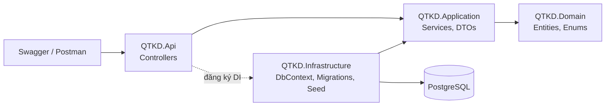
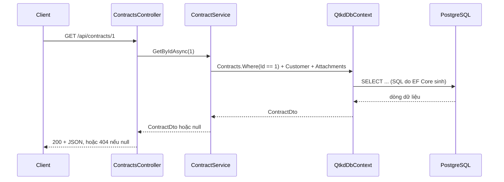
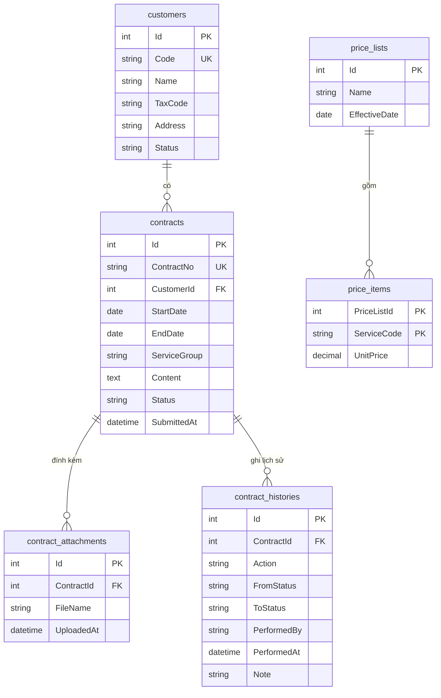

# Tổng quan solution QTKD

## Các thành phần và chiều phụ thuộc

| Project | Vai trò |
|---|---|
| QTKD.Domain | Entity, enum, exception nghiệp vụ; không phụ thuộc project nào |
| QTKD.Application | Interface, DTO, service xử lý nghiệp vụ (Tuần 06 đặt CTR-01..03 tại đây) |
| QTKD.Infrastructure | EF Core, DbContext, migration, seed dữ liệu |
| QTKD.Api | Controller HTTP, cấu hình, Swagger |
| tests/QTKD.UnitTests | Unit test nghiệp vụ (Tuần 07) |
| tests/QTKD.IntegrationTests | Test API + database kiểm thử riêng (Tuần 07) |

## Quy trình một request: `GET /api/contracts/1`

## Quan hệ giữa các bảng

